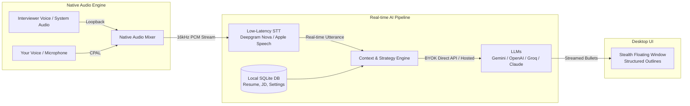

<div align="center">


# OnCue

**Local-first desktop AI interview copilot & career preparation engine for macOS and Windows.**

[](https://www.oncue.top)
[](https://github.com/FluxAether/oncue/releases/latest)
[](https://github.com/FluxAether/oncue/releases)
[]()
[](LICENSE)

[🌐 官方网站 (Official Website)](https://www.oncue.top) · [English Portal](https://www.oncue.top/en) · [⬇️ 客户端下载](https://github.com/FluxAether/oncue/releases/latest) · [实时辅助指南](https://www.oncue.top/features/live-copilot) · [模拟面试指南](https://www.oncue.top/features/mock-interview) · [订阅与额度](https://www.oncue.top/subscribe)

<br />


</div>

---

## Overview / 产品概述

**OnCue** is a local-first desktop AI interview copilot and career preparation engine for **macOS** and **Windows**, built with **Tauri 2 (Rust)** and **React 19**.

OnCue captures crystal-clear system output audio and microphone speech in real time with zero acoustic feedback. It transcribes conversations with sub-second latency and displays structured, bite-sized answer hints in a discreet floating outline window. It also features realistic multi-turn voice mock interviews and semantic resume optimization tailored to target job descriptions.

All resumes, audio recordings, transcripts, settings, and BYOK credentials remain stored exclusively on your local device's encrypted SQLite database.

---

## Why OnCue? / 为什么选择 OnCue

| 维度 / Dimension | 普通网页端 AI (ChatGPT / Claude / Web) | OnCue 桌面端 / OnCue Desktop |
| :--- | :--- | :--- |
| **音频采集**<br>Audio Capture | 依赖麦克风采集外放，易啸叫、环境杂音大、漏字严重 | **原生系统音频回环内录**（AudioTee / WASAPI），无啸叫直接混音 |
| **操作隐蔽性**<br>Stealth & Focus | 频繁切屏换标签页，极易被察觉或被在线会议屏幕共享捕获 | **独立隐形悬浮窗**，全局快捷键一键秒显隐，专为面试设计 |
| **内容呈现**<br>Answer Outline | 生成大段冗长文本，面试现场来不及细看、极易卡壳念稿 | **实时结构化提纲**，核心关键词高亮，即看即说、自然应对 |
| **数据隐私**<br>Privacy First | 简历、面经与个人问答上传云端参与模型训练 | **本地优先（Local-First）**，简历与密钥全在本地 SQLite，BYOK 直连 |
| **求职闭环**<br>Full Lifecycle | 仅单次问答交互 | **靶向简历优化 ➔ 语音对练模拟 ➔ 实时面试辅助 ➔ 面后复盘回溯** |

---

## How It Works / 技术架构



---

## Features / 核心功能特性

### 1. Stealth Copilot (实时隐形面试辅助)
- **双通道无损采集**：支持系统音频回环（WASAPI Loopback / AudioTee）与麦克风混音，精准收录面试官语音与候选人回答，绝无外放回授。
- **极速低延迟转录**：支持 Deepgram Nova-2 / Nova-3 实时流式语音转录，以及 macOS 原生离线识别。
- **结构化答题提纲**：大模型实时抓取面试官问题核心，输出清晰条理的要点、数据佐证与技术关键词，助你自信作答，避免死板读稿。
- **隐形与悬浮控制**：轻巧小窗置顶显示，全局快捷键随时召唤或隐藏。
- 📖 [查看实时辅助详细指南](https://www.oncue.top/features/live-copilot)

### 2. AI Mock Interviews (多轮语音实战模拟)
- **精准题库定制**：结合候选人上传的简历与目标岗位 JD，自动分析技术盲区，生成针对性面试题。
- **自然语音对练**：支持实时语音多轮追问、压力测试与反问互动，还原真实大厂面试现场。
- **深度复盘报告**：面试结束后自动生成多维度评分报告，包括技术匹配度、结构化表达与优化建议。
- 📖 [查看模拟面试详细指南](https://www.oncue.top/features/mock-interview)

### 3. Targeted Resume Optimizer (简历针对性优化)
- **语义深度匹配**：逐条对比简历与职位要求，识别缺漏技能与关键词。
- **量化成果强化**：基于 STAR 原则辅助重写工作经历，提升简历初筛通过率。
- **本地导出**：支持一键导出排版规整的 DOCX 文件。

### 4. Session History & Review (面试复盘与录音回溯)
- 自动归档每次面试与模拟对练的完整问答记录、提纲和可选原生录音文件。
- 便于回顾薄弱问题，持续迭代面试表现。

### 5. Multi-language & UI Themes (多语言与主题)
- 支持 **简体中文**、**繁體中文** 与 **English**。
- 提供 **浅色（Light）**、**深色（Dark）** 与 **跟随系统（System）** 三种外观。

---

## App Previews / 界面预览

<div align="center">
  <table>
    <tr>
      <td width="50%">
        
        <p align="center"><b>控制面板 (Dashboard)</b></p>
      </td>
      <td width="50%">
        
        <p align="center"><b>实时面试辅助 (Stealth Copilot)</b></p>
      </td>
    </tr>
    <tr>
      <td width="50%">
        
        <p align="center"><b>AI 模拟面试 (Mock Interview)</b></p>
      </td>
      <td width="50%">
        
        <p align="center"><b>简历优化 (Resume Optimizer)</b></p>
      </td>
    </tr>
  </table>
</div>

---

## Download & Installation / 下载安装

直接从 [GitHub Releases](https://github.com/FluxAether/oncue/releases/latest) 或 [官方网站](https://www.oncue.top) 获取预编译安装包：

| 平台 / Platform | 系统要求 / Requirements | 架构 / Arch | 安装包 / Package |
| :--- | :--- | :--- | :--- |
| **macOS** | macOS 14.2+ (推荐，支持系统内录) / 13.0+ | Universal (Apple Silicon & Intel) | [⬇️ 下载 .dmg](https://github.com/FluxAether/oncue/releases/latest) |
| **Windows** | Windows 10 / 11 (64-bit) | x64 | [⬇️ 下载 .exe 安装包](https://github.com/FluxAether/oncue/releases/latest) |

> 🍎 **macOS 用户须知**：macOS 14.2+ 使用内置 AudioTee 侧载程序进行系统音频捕获。首次启动开启音频监听时，请在系统弹窗中允许“系统音频录制”权限（OnCue 不需要也不会请求屏幕录制权限）。
>
> 🪟 **Windows 用户须知**：Windows 采用 WASAPI 共享模式回环采集默认播放设备声音。若切换了默认输出耳机或扬声器，请在应用中重启捕获。

---

## Supported AI Providers (BYOK) / 模型服务支持

OnCue 支持 **自带 API Key（BYOK，直连服务商）** 与 **托管账户（Hosted Credits）** 两种使用模式：

- **语音识别 (STT)**:
  - [Deepgram](https://deepgram.com) (Nova-2 / Nova-3, 极速实时流式转录)
  - Apple Speech Recognition (macOS 本地离线识别，免费)
- **大语言模型 (LLM)**:
  - [Google Gemini](https://ai.google.dev) (Gemini 2.5 Flash / Pro)
  - [OpenAI](https://platform.openai.com) (GPT-4o / GPT-4o-mini)
  - [Groq](https://groq.com) (极速推理)
  - [Anthropic Claude](https://anthropic.com) (Claude 3.5 Sonnet)

> 🔐 **安全与隐私提示**：在 BYOK 模式下，API 密钥存储在本地 SQLite 数据库中 (`com.oncue.desktop`)，调用时由桌面客户端直接向各服务商官方 API 发起请求，不经过任何中转服务器。

---

## Getting Started (Developers) / 本地开发

### Prerequisites
- Node.js 20+
- Rust stable
- macOS 14.2+ (如需编译系统音频捕获 sidecar，需 Swift 工具链)

### Run in Development
```bash
# 安装依赖
npm install

# 启动桌面端完整开发环境 (Tauri + Vite)
npm run tauri dev

# macOS 启用原生系统音频捕获开发环境
npm run tauri:mac-audio

# 仅前端调试 (无原生音频与窗口特性)
npm run dev
```

### Build Packages
```bash
# 当前系统打包
npm run tauri build

# macOS 通用安装包 (.dmg)
npm run build:mac

# Windows x64 安装包 (.exe)
npm run build:win
```

### Verification Checks
```bash
npm run lint
npm run verify:copilot
npm run verify:mock
npm run verify:resume
npm run verify:theme
npm run verify:db-storage
```

---

## Audio Capture Architecture / 音频捕获设计

Stealth Copilot 支持分别或同时监听麦克风与系统声音：

- **macOS (14.2+)**：集成编译固定 commit 的 [AudioTee](https://github.com/makeusabrew/audiotee) sidecar，提供 16kHz 单声道系统内录。麦克风使用 `cpal` 捕获，两路在原生 Rust 层混合。
- **Windows**：基于 `cpal` 的 WASAPI Loopback 捕获默认播放设备渲染流，并与麦克风音频流做原生混音。
- **隐私沙盒**：音频仅在本地进行 PCM 缓冲并在需要时流向 STT 服务商，不上传未经用户授权的第三方服务器。

---

## Star History / 社区热度

[](https://star-history.com/#FluxAether/oncue&Date)

---

## Official Links & Resources / 官方链接

- 🌐 **官方主页 (Official Website)**: [https://www.oncue.top](https://www.oncue.top)
- 🌐 **英文门户 (English Portal)**: [https://www.oncue.top/en](https://www.oncue.top/en)
- 🎯 **实时面试辅助指南 (Live Copilot)**: [https://www.oncue.top/features/live-copilot](https://www.oncue.top/features/live-copilot)
- 🎙️ **模拟面试指南 (Mock Interview)**: [https://www.oncue.top/features/mock-interview](https://www.oncue.top/features/mock-interview)
- 💳 **额度与订阅 (Plans & Credits)**: [https://www.oncue.top/subscribe](https://www.oncue.top/subscribe) ([English](https://www.oncue.top/en/subscribe))
- 📦 **GitHub 仓库**: [https://github.com/FluxAether/oncue](https://github.com/FluxAether/oncue)
- 🚀 **版本发布日志 (Releases)**: [https://github.com/FluxAether/oncue/releases](https://github.com/FluxAether/oncue/releases)

---

## Fair Use & Compliance / 免责与合规声明

OnCue 旨在帮助求职者进行面试准备、知识体系巩固、思路梳理与模拟练习。请在相关面试、评测或公司明确允许使用辅助工具的合规场景下使用实时辅助功能。

---

## License

This project is licensed under the [MIT License](LICENSE).
